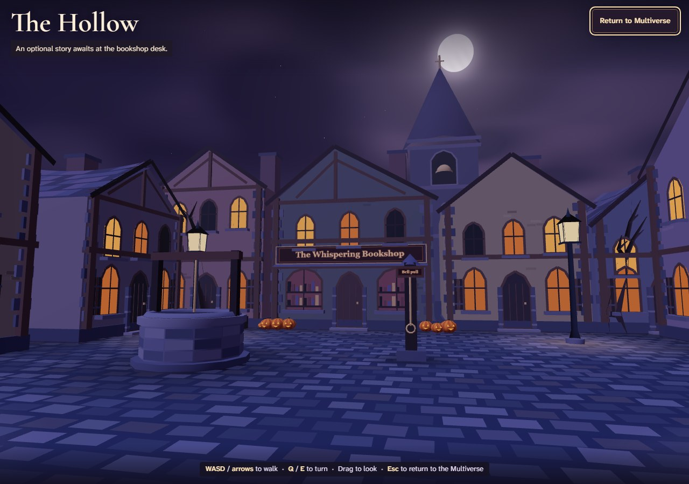
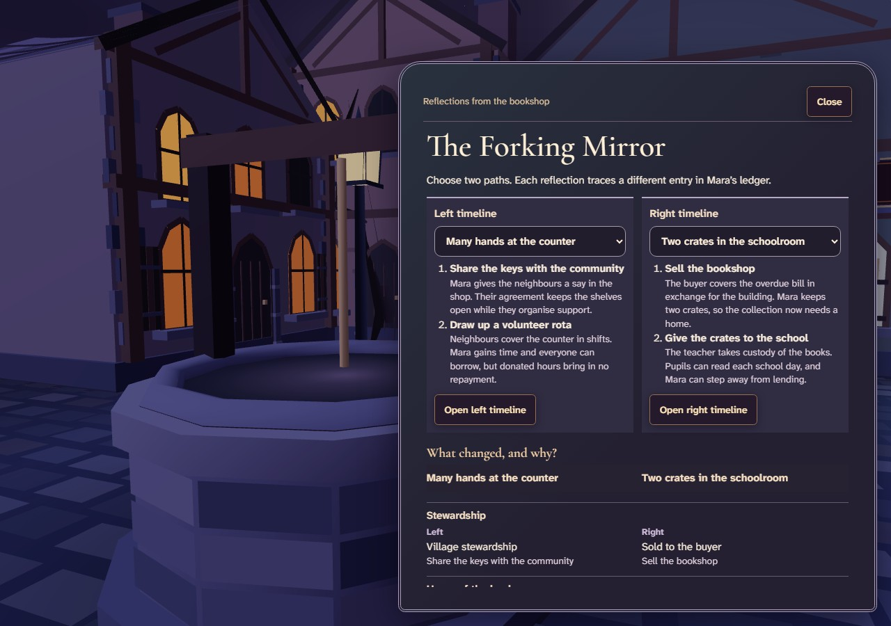

# RealityFork

**Walk through a what-if before you live it.** RealityFork turns a decision into a map of possible futures. Change one assumption, keep the original path, and compare what follows. Start with [the hosted 3D experience](https://realityfork-final.onrender.com/?preview=atlas).

## Start in The Hollow

Click the illuminated **The Hollow** island to visit the 3D village. Keyboard users can activate **Enter The Hollow** with Enter or Space. On touch, tap the island to reveal the entrance and tap it again to enter. In the Whispering Bookshop, read the Keeper’s Desk and begin **Mara’s Choice**. Decide what to do with the bookshop, visit the Whispering Well for a second choice, then use the **Forking Mirror** to compare timelines. The chapter uses authored rules and tracks consequences such as the debt, who can read the books, and who covers the work.

**Explore Your Own What-If** returns to the decision planner. Open a built-in city, solar, or café example or start a blank map. The judge AI flow can draft choices and possible consequences, and **Ask AI to take another look** can draft a revision for one changed path. Review suggestions before saving. Example figures are illustrative. Calculated results come from the path’s recorded inputs and formulas. The café example uses a separate, seeded queue simulator.





See the [screenshot guide](docs/submission/kiroween-2026/demo.md#screenshots-and-thumbnail) for capture context.

## Run locally

Use Node.js 22 or 24 with npm. From the repository root:

```sh
npm ci
npm run dev
```

Open [the Vite preview](http://localhost:5173/?preview=atlas) or use the port shown by Vite. Keep the development server local. The 3D experience needs WebGL. The decision planner and its standard Explore view remain available on devices without WebGL. Use the keyboard controls or the on-screen touch controls in The Hollow.

To serve the production build locally:

```sh
npm run build
npm start
```

Open [the production preview](http://localhost:8080/?preview=atlas). A clean setup supports the chapter, examples, and manual planner without credentials. The optional production AI endpoints require server-side Groq and judge-session configuration. See [judge AI access](docs/judge-ai-access.md) and [.env.example](.env.example) for maintainer setup. Saved decision maps stay in this browser and can be exported and imported. When you request AI drafting or Revisit, the relevant question and path context are sent to the provider.

## Architecture

| Workspace | Role |
| --- | --- |
| [packages/core](packages/core) | TypeScript domain logic for branch lineage, fingerprints, formula evaluation, planner proposals, and seeded simulation. |
| [packages/web](packages/web) | React interface, browser persistence, and Three.js rendering for the Atlas and The Hollow. The Node server serves the production build and handles the optional AI endpoints. |
| [packages/cli](packages/cli) | Reproduction, simulation benchmarks, and synthetic-data tools. |

## Verify

```sh
npm run typecheck
npm test
npm run benchmark
npx playwright install chromium
npm run build
```

For production browser tests, run from the repository root with `RF_E2E_PROD=1` and `GROQ_API_KEY` unset:

```sh
npm run e2e -- e2e/hollow.spec.ts e2e/bookshop.spec.ts e2e/judge-access.spec.ts e2e/reactive.spec.ts e2e/atlas-fallback.spec.ts
```

The judge tests use a mocked provider. Browser suites write test captures in the checkout. The benchmark regenerates its report files under `docs/validation/`.

## Kiro and credits

- [Core requirements](.kiro/specs/realityfork-core/requirements.md), [design](.kiro/specs/realityfork-core/design.md), and [tasks](.kiro/specs/realityfork-core/tasks.md).
- Steering for [product scope](.kiro/steering/product.md), [technology](.kiro/steering/tech.md), [simulation correctness](.kiro/steering/simulation-correctness.md), and [claims](.kiro/steering/claims-policy.md).
- [Core test hook configuration](.kiro/hooks/core-tests-on-save.json) and [Kiro development evidence](docs/submission/kiroween-2026/kiro-usage.md).
- [Asset and dependency credits](docs/submission/kiroween-2026/asset-credits.md) and [full third-party notices](THIRD_PARTY_NOTICES.txt). The project code is under the [MIT License](LICENSE).
- [Submission and release evidence](docs/submission/kiroween-2026/README.md). This source snapshot preserves the reviewed app and its assets. Local production builds also serve the notices at `/THIRD_PARTY_NOTICES.txt`.
